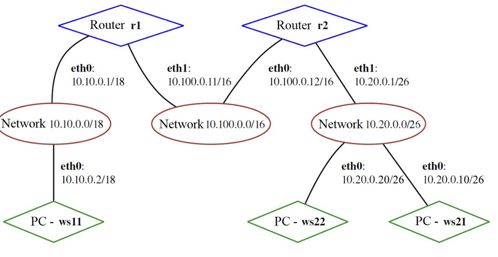

# Linux Networking Lab

**Задача:** собрать в VirtualBox сеть из пяти узлов на Ubuntu Server 20.04 — два роутера и три хоста — и настроить на ней статическую маршрутизацию, DHCP, фаервол, SNAT/DNAT и SSH-туннели. Каждый шаг проверен трафиком: `ping`, `traceroute`, `tcpdump`, `telnet`, `iperf3`, `nmap`.

**Стек:** Ubuntu Server 20.04, Netplan (systemd-networkd), iproute2, sysctl, iptables (filter + nat), isc-dhcp-server, Apache2, OpenSSH, tcpdump, traceroute, iperf3, nmap, ipcalc

## Топология



На схеме интерфейсы подписаны как `eth0`/`eth1`, в VM это `enp0s3`/`enp0s8`.

| Узел | Роль | enp0s3 | enp0s8 | Конфиги |
|---|---|---|---|---|
| **r1** | роутер; DHCP для 10.10.0.0/18 | 10.10.0.1/18 | 10.100.0.11/16 | [r1/](configs/multi-node/r1) |
| **r2** | роутер; DHCP для 10.20.0.0/26; фаервол, SNAT, DNAT | 10.100.0.12/16 | 10.20.0.1/26 | [r2/](configs/multi-node/r2) |
| **ws11** | хост | 10.10.0.2/18, gw 10.10.0.1 | — | [ws11/](configs/multi-node/ws11) |
| **ws21** | хост; потом клиент DHCP | 10.20.0.10/26 → DHCP | — | [ws21/](configs/multi-node/ws21) |
| **ws22** | веб-сервер Apache | 10.20.0.20/26, gw 10.20.0.1 | — | [ws22/](configs/multi-node/ws22) |

Сети: `10.10.0.0/18` (r1 – ws11), `10.100.0.0/16` (r1 – r2), `10.20.0.0/26` (r2 – ws21, ws22).

Отдельный стенд из двух узлов (маршрутизация, iperf3, фаервол): **ws1** `192.168.100.10/16` ↔ **ws2** `172.24.116.8/12` через внутреннюю сеть `enp0s8` — [configs/two-host-lab/](configs/two-host-lab).

## Что сделано

### 1. Статическая маршрутизация между двумя сетями (ws1 ↔ ws2)
- Временно: `ip route add 172.16.0.0/12 dev enp0s8` и `ip route add 192.168.0.0/16 dev enp0s8` → ping 0% loss.
- Постоянно: маршруты в `routes:` netplan; после reboot ping 0% loss.
- Скриншоты: [temp route](screenshots/01-two-host-routing/ping-temp-route.jpg) · [после reboot](screenshots/01-two-host-routing/ping-after-reboot.jpg)

### 2. Пропускная способность (iperf3)
- `iperf3 -s` на ws2, `iperf3 -c 172.24.116.8` на ws1: **2.49 GB за 10 с, 2.14 Gbit/s sender / 2.13 Gbit/s receiver, 9557 retransmits**.
- Больше 1 Gbit/s, потому что обе VM на одном хосте: трафик идёт через виртуальный коммутатор, физической сетевой карты на пути нет.
- [Скриншот](screenshots/02-iperf3/iperf3-result.jpg)

### 3. Фаервол iptables: порядок правил
- `/etc/firewall.sh` на обоих узлах: `-F`, `-X`, открыты TCP 22 и 80, два правила для ICMP echo-reply в цепочке OUTPUT.
- ws1: сначала `DROP`, потом `ACCEPT` → ping 100% loss. ws2: сначала `ACCEPT`, потом `DROP` → ping 0% loss. Срабатывает первое совпавшее правило.
- `nmap 192.168.100.10` показывает `Host is up`, хотя ping блокируется.
- [ws1 blocked](screenshots/03-firewall/ws1-ping-blocked.jpg) · [ws2 ok](screenshots/03-firewall/ws2-ping-ok.jpg) · [nmap](screenshots/03-firewall/nmap-host-up.jpg)

### 4. Маршрутизация в сети из пяти узлов
- На r1/r2 включён `net.ipv4.ip_forward=1`: сразу через `sysctl -w` и постоянно в `/etc/sysctl.conf` + `sysctl -p`.
- На хостах `gateway4` указывает на свой роутер; на r1 маршрут `10.20.0.0/26 via 10.100.0.12`, на r2 — `10.10.0.0/18 via 10.100.0.11`.
- **Longest prefix match:** на ws11 `ip r list 10.10.0.0/18` → connected-маршрут, `ip r list 0.0.0.0/0` → `default via 10.10.0.1`. Для своей сети выбирается `/18`, а не `/0`.
- **traceroute ws11 → ws21:** `10.10.0.1 → 10.100.0.12 → 10.20.0.10`. В `tcpdump -tnv` на r1 видны UDP-пробы на порты 33442–33445 с растущим TTL и ответы `ICMP udp port unreachable` от цели.
- **ICMP при ошибке маршрутизации:** `ping 10.30.0.111` с ws11 → r1 отвечает `Destination Net Unreachable`; то же видно в `tcpdump -n -i enp0s3 icmp` на r1.
- Скриншоты: [ip r ws11](screenshots/04-multi-node-routing/ws11-ip-r.jpg) · [ip r r1](screenshots/04-multi-node-routing/r1-ip-r.jpg) · [longest prefix](screenshots/04-multi-node-routing/ws11-longest-prefix.jpg) · [tcpdump r2](screenshots/04-multi-node-routing/r2-tcpdump-icmp.jpg) · [traceroute](screenshots/04-multi-node-routing/traceroute-ws11-ws21.jpg) · [tcpdump traceroute](screenshots/04-multi-node-routing/r1-tcpdump-traceroute.jpg) · [net unreachable](screenshots/04-multi-node-routing/ping-unreachable-net.jpg) · [tcpdump unreachable](screenshots/04-multi-node-routing/r1-tcpdump-net-unreachable.jpg)

### 5. DHCP (isc-dhcp-server)
- **r2:** пул `10.20.0.2–10.20.0.50`, `option routers 10.20.0.1`, сервер слушает `enp0s8`. ws21 после reboot получила `10.20.0.2/26 dynamic`, ping ws22 — 0% loss.
- `dhclient -v` на ws21: полный цикл DISCOVER → OFFER → REQUEST → ACK, `bound to 10.20.0.3`. Старая аренда осталась как `secondary`; `dhclient -r` + `dhclient` оставили один адрес.
- **r1:** резервирование `host ws11 { hardware ethernet 10:10:10:10:10:BA; fixed-address 10.10.0.50; }`, на ws11 в netplan задан `macaddress` — результат см. в [примечании 3](#3-dhcp-по-mac-на-r1-цикл-не-завершён).
- Скриншоты: [r2 dhcpd](screenshots/05-dhcp/r2-dhcpd-active.jpg) · [lease ws21](screenshots/05-dhcp/ws21-dhcp-lease.jpg) · [DORA](screenshots/05-dhcp/ws21-dhclient-dora.jpg) · [secondary](screenshots/05-dhcp/ws21-secondary-ip.jpg) · [release/renew](screenshots/05-dhcp/ws21-release-renew.jpg) · [r1 offers](screenshots/05-dhcp/r1-dhcp-offer-mac.jpg) · [ws11 без IPv4](screenshots/05-dhcp/ws11-no-ipv4.jpg)

### 6. NAT и фаервол на r2
Правила собирались по шагам; итоговый скрипт — [r2/firewall.sh](configs/multi-node/r2/firewall.sh).

| Шаг | Правило | Проверка |
|---|---|---|
| Default deny | `iptables -P FORWARD DROP` | r1 → ws22 `ping 10.20.0.20`: 100% loss |
| ICMP | `-A FORWARD -p icmp -j ACCEPT` | ping 0% loss, ttl 63 (один хоп через r2) |
| SNAT | `ESTABLISHED,RELATED` + `-s 10.20.0.0/26 -j ACCEPT` + `-t nat POSTROUTING -s 10.20.0.0/26 -o enp0s3 -j MASQUERADE` | ws22 → `telnet 10.100.0.11 80` (Apache на r1): Connected |
| DNAT | `-t nat PREROUTING -p tcp --dport 8080 -j DNAT --to-destination 10.20.0.20:80` + `FORWARD -d 10.20.0.20 --dport 80 -j ACCEPT` | r1 → `telnet 10.100.0.12 8080`: Connected (проброс на Apache ws22) |

[forward drop](screenshots/06-nat/forward-drop.jpg) · [icmp](screenshots/06-nat/icmp-allowed.jpg) · [SNAT](screenshots/06-nat/snat-telnet.jpg) · [DNAT](screenshots/06-nat/dnat-telnet-8080.jpg)

### 7. SSH-туннели
- Apache на ws22 переведён на `Listen localhost:80` ([конфиг](configs/multi-node/ws22/apache-ports-tunnel.conf)): прямой `telnet 10.20.0.20 80` с ws21 → `Connection refused`.
- **Local forwarding** (ws21 → ws22): `ssh -L 8080:127.0.0.1:80 amuser@10.20.0.20`, затем на ws21 `telnet 127.0.0.1 8080` → Connected.
- **Remote forwarding** (ws22 → ws11): `ssh -R 8080:127.0.0.1:80 amuser@10.10.0.2`, затем на ws11 `telnet 127.0.0.1 8080` → Connected.
- [direct refused](screenshots/07-ssh-tunnels/direct-refused.jpg) · [-L сессия](screenshots/07-ssh-tunnels/local-forward-session.jpg) · [-L telnet](screenshots/07-ssh-tunnels/telnet-local-8080.jpg) · [-R](screenshots/07-ssh-tunnels/ssh-remote-forward.jpg) · [-R telnet](screenshots/07-ssh-tunnels/telnet-remote-8080.jpg)

### ipcalc (расчёты)
`192.167.38.54/13` → сеть `192.160.0.0`; `/15` = `255.254.0.0`; `11111111.11111111.11111111.11110000` = `255.255.255.240` = `/28`; `12.167.38.4/23` → хосты `12.167.38.1 – 12.167.39.254`; допустимые шлюзы для `10.10.0.0/18`: `10.10.0.2`, `10.10.10.10`, `10.10.1.255` (диапазон хостов `10.10.0.1 – 10.10.63.254`).

## Примечания и найденные ошибки

#### 1. Маршрут через собственный IP (ws1 / ws2)
В netplan маршрут записан как `to: 172.16.0.0/12, via: 192.168.100.10` — `via` указывает на адрес самого ws1 (на ws2 так же: `via: 172.24.116.8`). Это работало: ping 0% loss после reboot. Корректнее маршрут через интерфейс без шлюза — так, как он был задан вручную: `ip route add 172.16.0.0/12 dev enp0s8`. Конфиг в [configs/two-host-lab/](configs/two-host-lab) оставлен как есть, чтобы сохранить историческую точность.

#### 2. DNS в DHCP на r2
`option domain-name-servers 10.20.0.1` указывает на r2, но DNS-сервер на r2 не запущен: клиенты получали адрес несуществующего резолвера. Для лабораторной DNS не требовался — проверки шли по IP. В продакшене здесь должен быть реальный DNS (например, `8.8.8.8`) или локальный `dnsmasq` / `unbound` на роутере. Конфиг оставлен дословно.

#### 3. DHCP по MAC на r1: цикл не завершён
r1 корректно находит резервирование: в `journalctl -u isc-dhcp-server` видно `DHCPDISCOVER from 10:10:10:10:10:ba` → `DHCPOFFER on 10.10.0.50`. Но `DHCPREQUEST`/`DHCPACK` в логе нет, DISCOVER повторяется каждые 10–60 с, а на ws11 у `enp0s3` нет IPv4 — клиент OFFER не принял.
**Гипотеза (не проверена):** MAC в netplan (`10:10:10:10:10:BA`) отличается от MAC адаптера в настройках VirtualBox, и VirtualBox при `Promiscuous Mode: Deny` не доставляет в VM кадры, адресованные «чужому» MAC. Проверка: задать `1010101010BA` в *Settings → Network → Adapter → MAC Address* вместо netplan или включить *Promiscuous Mode: Allow VMs*, затем `sudo dhclient -v enp0s3` на ws11 и `tcpdump -n -e port 67 or port 68` на обеих сторонах.

#### 4. Опечатка в команде SSH local forwarding
На одном из кадров команда набрана как `ssh -l 8080:127.0.0.1:80 …`: строчная `-l` — это имя пользователя, и SSH запросил пароль для пользователя `8080:127.0.0.1:80`. Правильный ключ — заглавная `-L`. На следующем кадре сессии видно `Could not request local forwarding` — порт 8080 на ws21 уже был занят предыдущей сессией туннеля. Сам туннель подтверждён: `telnet 127.0.0.1 8080` на ws21 → `Connected to 127.0.0.1` ([скриншот](screenshots/07-ssh-tunnels/telnet-local-8080.jpg)) при том, что прямое подключение к ws22:80 отклоняется.

## Как проверить

На роутерах:
```bash
sysctl net.ipv4.ip_forward                 # = 1
ip r                                       # статические маршруты к соседним сетям
sudo iptables -L FORWARD -n -v             # policy DROP + разрешающие правила
sudo iptables -t nat -L -n -v              # MASQUERADE и DNAT :8080
systemctl status isc-dhcp-server
```
На хостах:
```bash
traceroute 10.20.0.10                      # с ws11: 10.10.0.1 → 10.100.0.12 → 10.20.0.10
sudo tcpdump -n -i enp0s3 icmp             # на r1 при ping несуществующей сети
sudo dhclient -v enp0s3                    # на ws21: DISCOVER/OFFER/REQUEST/ACK
telnet 10.100.0.12 8080                    # с r1: DNAT на Apache ws22
```

## Результат
- Пять узлов в трёх подсетях связаны статической маршрутизацией; путь пакета подтверждён `traceroute` и `tcpdump`.
- r2 работает как пограничный роутер: default-deny FORWARD, SNAT для `10.20.0.0/26`, DNAT `:8080 → 10.20.0.20:80`.
- DHCP с пулом на r2 работает, включая обновление и освобождение аренды; резервирование по MAC на r1 сервер обрабатывает, клиентская сторона не доведена (примечание 3).
- Сервис, слушающий только `localhost`, опубликован через SSH local и remote forwarding.
- Пропускная способность между VM — 2.14 Gbit/s (iperf3).
